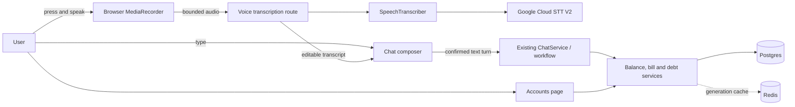

# Phase 6: balances, bills, debt and Indian-language voice

Status: approved for implementation on 25 November 2026
Integration branch: `phase-6/integration`
Tickets: `issues/` in this directory

## Level and assumptions

MoneyMoney remains an L1 product by traffic: assume fewer than 1,000 daily users, less than 10
peak requests per second, one to three engineers and data that fits comfortably in the existing
Postgres instance. Financial correctness promotes the balance and liability paths to production
reliability even at that size: an unknown balance must never be displayed as zero, a payment must
never be counted twice and audio must never create a financial record without the existing review
and confirmation path.

Keep the modular monolith, Postgres, Redis, FastAPI, Next.js and the current LangGraph workflow.
Add no queue, event bus, second database, real-time voice service or new deployable. Voice uses
short request/response transcription; every accepted transcript re-enters the existing text turn.

Assumptions to validate during implementation:

- voice messages are short commands, capped at 45 seconds and 8 MB;
- users choose English, Hindi/Hinglish or Gujarati for a recording instead of relying on preview
  automatic language detection;
- raw audio is processed in memory and discarded; the editable transcript is retained only when
  the user sends it as a normal chat message;
- balances are useful after an explicit dated anchor; pre-anchor history is not silently treated
  as complete;
- a loan is a liability account with a simple due plan, not an amortisation engine.

## Problem statement

MoneyMoney records activity but cannot answer “how much is in HDFC?”, “what do I owe on my card?”
or “which payment is due next?”. Treating missing history as a zero opening balance would produce
confident but wrong answers. Shared expenses and settlements also mean that summing ordinary
transactions is not the same as following cash through an account.

The chat is English-first. It can parse `2 lakh`, but not Gujarati digits, common Hindi/Gujarati
number phrases or spoken, code-mixed input. Users must type even when a short voice command would
be faster.

## Solution

Deliver two ordered tracks on the same domain services:

1. **Balances and liabilities.** Add explicit balance anchors, asset/liability account semantics,
   a deterministic cash-effect read model, credit-card bills and simple loan due plans. Add an
   Accounts page with known balances and upcoming obligations, kept separate by currency.
2. **Indian-language chat and voice.** Extend deterministic normalisation and measured intent
   understanding for English, Hinglish and Gujarati. Add push-to-talk transcription that returns
   editable text before the user sends it through the existing chat workflow.

The language model and speech recogniser may interpret words. They never calculate balances,
allocate payments, choose amounts or bypass confirmations.

## Domain model and invariants

### Accounts and balances

- Account kinds are `bank`, `wallet`, `cash`, `credit_card`, `loan` and `other`.
- Bank, wallet, cash and other accounts are **asset accounts** by default. Credit-card and loan
  accounts are **liability accounts**. The kind determines the balance direction and cannot be
  overridden per request.
- Changing an anchored account across the asset/liability boundary would reinterpret its entire
  history, so it is rejected. The user must clear/re-establish the anchor deliberately; an account
  with a bill or debt plan cannot change to an incompatible kind.
- An account has an optional **balance anchor**: an exact signed amount and a local calendar date. The
  amount is what was held (asset) or owed (liability) at the start of that date. Movements dated on
  or after the anchor date change it. Without an anchor, the current balance is unknown.
- Anchor amounts are signed: positive means held for an asset or owed for a liability; negative
  means an asset overdraft or liability credit. The API and UI require the user to choose/confirm
  that meaning and label it rather than relying on a bare minus sign.
- Account currency remains fixed. Every balance, bill, plan and payment uses that currency.
- Asset balance delta is money in minus money out. Liability amount-owed delta is money out through
  the liability minus money paid into it.
- Ordinary income/expense, both ends of transfers, statement imports and account-tagged friend
  settlements contribute their real cash effect.
- A shared expense affects reports through each participant's share, as today. It affects the
  payer's account balance by the full amount paid. A non-payer's share does not move an account at
  purchase time. This preserves ADR 0001 while making cash balances correct.
- Deleted/undone records stop contributing. Edits, import undo and shared-expense changes
  invalidate the same user generation used by other ledger reads.
- Per-currency asset, liability and net-position totals include known anchored accounts only and
  name excluded unknown accounts. Unlike currencies are never combined (ADR 0002).

### Credit-card bills

- A **credit-card bill** belongs to one credit-card account and has a statement period, statement
  date, due date, exact total due and optional minimum due. Statement periods for one card may not
  overlap; statement dates are unique per card.
- A **bill payment** allocates part or all of an existing transfer into that credit-card account.
  The allocation currency must match, cannot exceed the transfer amount and cannot make aggregate
  allocations exceed it.
- New card-payment transfers allocate to the oldest unpaid bill by due date, then the next, up to
  the payment amount. Any remainder still reduces the card's amount owed but is unallocated.
- Editing/deleting/restoring a payment or bill recomputes allocations deterministically in one
  database transaction. The API may also move an allocation explicitly when the user corrects it.
- Bill status is computed, never hand-set: `open`, `partially_paid`, `paid` or `overdue`. Minimum-due
  progress is separate from total-due progress.
- Recording a bill does not add an expense or change the account balance; purchases already did.
  Paying a bill is a transfer, not spending.

### Debt plans

- A **debt plan** belongs one-to-one to a loan account and records lender, optional installment
  amount, cadence, next due date and optional note.
- Borrowing is a transfer from the loan account to an asset account and increases the amount owed.
  Repayment is a transfer into the loan account and decreases it.
- The plan is a reminder and progress view. MoneyMoney does not calculate interest, principal vs
  interest, amortisation, penalties or an inferred payoff date. The user can set a new dated anchor
  from a lender statement when interest or fees change the real balance.
- Due state is computed from the plan and qualifying repayments. A skipped or changed installment
  is explicit; no recurring transaction is fabricated.

### Language and voice

- **Assistant language** is separate from formatting locale. Initial choices are English,
  Hinglish and Gujarati. Hinglish is not treated as a locale code.
- Text input accepts Latin, Devanagari and Gujarati scripts and code-mixing. Deterministic
  normalisation covers Gujarati digits and a bounded, tested vocabulary for Indian number units
  and common fractional forms; the LLM is cross-checked against the normalised amount.
- Fixed clarifications, confirmations, save replies and errors have owned translations. Category,
  merchant and account names remain user data and are never translated. The rest of the web app
  remains English in this phase.
- Voice is push-to-talk, not an always-listening assistant. The browser records with
  `MediaRecorder`, sends one bounded audio blob to the API and receives a transcript. The user can
  edit or discard it; only selecting Send creates a normal chat turn.
- Raw audio is not stored in Postgres, object storage, logs, analytics or chat history. Request
  logs contain duration, byte size, selected language, provider latency and outcome, never audio or
  transcript text.
- Microphone permission is requested only after the user presses the control. Text input remains
  fully usable when permission is denied, the browser lacks recording support or transcription is
  unavailable.

## User stories

### Known balances

1. As a user, I want to set how much an account held or owed on a specific date, so that balances
   start from a fact rather than an assumed zero.
2. As a user, I want each account to say whether it is an asset or liability and whether its
   balance is known, so that signs are not ambiguous.
3. As a user, I want imports, purchases, refunds, transfers, shared-expense payments and friend
   settlements reflected once, so that balances follow actual cash.
4. As a user, I want unknown accounts excluded and named in totals, so that partial coverage is not
   presented as complete net worth.
5. As a user, I want balances and net position kept separate by currency, so that rupees and
   dollars are never added.
6. As a user, I want to correct a balance anchor with an audit trail, so that later statements can
   reconcile interest, fees or missing history.

### Bills and debt

7. As a user, I want to record a card bill with its period, due date, total and minimum due, so that
   I know what must be paid and when.
8. As a user, I want a card payment linked to the oldest unpaid bill automatically and correctable,
   so that partial and multiple payments remain explainable.
9. As a user, I want upcoming, partially paid and overdue bills listed without creating duplicate
   expenses, so that paying a card never inflates spending.
10. As a user, I want a loan account with amount owed, lender, installment and next due date, so
    that simple debt progress is visible.
11. As a user, I want borrowings and repayments recorded as transfers, so that the asset account
    and liability change together.
12. As a user, I want interest and fees entered from real statements rather than estimated, so that
    MoneyMoney never invents a payoff schedule.
13. As a user, I want chat requests such as “what do I owe?”, “card bill is 24,500 due 5 Dec” and
    “paid 18,000 toward home loan from HDFC” to use the same deterministic services.

### Indian-language text and voice

14. As a user, I want to type or speak English, Hinglish or Gujarati, including code-mixed account
    and merchant names, so that I can record money naturally.
15. As a user, I want Gujarati digits and phrases such as lakh/crore, `dedh sau` and their tested
    Gujarati equivalents interpreted exactly, so that amounts are not guessed.
16. As a user, I want the assistant's chat replies in my chosen language while dates and money keep
    my locale formatting, so that language and numeric conventions do not conflict.
17. As a user, I want to inspect and edit a transcript before sending, so that a speech error cannot
    silently save the wrong amount.
18. As a user, I want voice to degrade to typing with a clear reason, so that microphone, browser
    or provider failures never block the chat.
19. As a user, I want MoneyMoney not to retain my raw audio, so that voice adds the minimum new
    privacy surface.

## API and contract

### Accounts

- Extend account create/update/view contracts with `loan`, optional signed `balanceAnchor` and a computed
  balance view. Anchor updates use optimistic locking or the account's existing update version once
  introduced; every change is audited.
- `GET /api/v1/accounts/overview` returns per-currency known asset/liability/net totals, counts of
  unknown accounts, upcoming obligations and account rows. No value is cached independently from
  the user's ledger generation.
- Account detail exposes a paginated, typed balance ledger whose rows carry source kind/id, date,
  money-in/money-out effect and resulting balance. It does not duplicate transaction descriptions.

### Bills and plans

- CRUD endpoints for `/api/v1/credit-card-bills` are user-scoped and reject non-card accounts,
  overlapping periods, dates in the wrong order, currency mismatch and over-allocation.
- Payment allocation endpoints link only the user's transfer into the bill's card account.
- CRUD endpoints for `/api/v1/debt-plans` are user-scoped and reject non-loan accounts.
- All write endpoints use idempotency keys where a retry could create a duplicate bill, plan or
  transfer. Errors use the existing envelope with stable codes.

### Voice

- `POST /api/v1/voice/transcriptions` accepts authenticated multipart audio plus selected language.
  It returns `transcript`, recognised language, duration and a request id; provider confidence is
  advisory and never treated as approval.
- The endpoint accepts only an explicit MIME allowlist after content sniffing, at most 45 seconds
  and 8 MB, one channel where supported. It has per-user and per-IP rate/cost limits.
- Introduce a provider-neutral `SpeechTranscriber`; the first implementation uses Google Cloud
  Speech-to-Text V2 behind configuration and ADC. Tests use a fake provider and never call Google.
- Prefer a regional maintained model with explicit `en-IN`, `hi-IN` or `gu-IN` language selection.
  Multi-language automatic detection remains out until its preview status, region and measured
  accuracy meet the release bar.

Current provider constraints to re-check when ticket 06 begins:

- synchronous recognition accepts at most one minute or 10 MB, so MoneyMoney's smaller cap leaves
  validation and encoding headroom;
- Gujarati `gu-IN` is supported by maintained V2 models, including `chirp_2` in
  `asia-southeast1`;
- browser recording formats vary, so the client probes `MediaRecorder.isTypeSupported()` and the
  server does not assume one container.

References: [Google Speech-to-Text V2 language support](https://docs.cloud.google.com/speech-to-text/docs/speech-to-text-supported-languages),
[quotas and limits](https://docs.cloud.google.com/speech-to-text/docs/quotas), and
[MediaRecorder](https://developer.mozilla.org/en-US/docs/Web/API/MediaRecorder/MediaRecorder).

## Architecture

Request walkthrough:

1. A typed message enters the current chat unchanged. A spoken message is first transcribed and
   returned to the composer; it has no financial effect yet.
2. The user edits and sends text. Existing replay, locking, clarification and confirmation rules
   apply identically regardless of input source.
3. The workflow selects a typed intent. Balance, bill and debt services validate account kind,
   currency, dates and ownership and perform all arithmetic in integer minor units.
4. Writes commit atomically with audit rows and generation invalidation. Replies render fixed,
   translated interaction contracts; the model supplies no monetary result.

## Testing and release gates

- Balance integration tests cover assets/liabilities, anchors, same-day movements, refunds,
  transfers, imports/undo, shared payer vs non-payer, settlements, deletion/restore, unknown
  accounts, multi-currency separation and user isolation.
- Bill tests cover overlap/date rules, partial/multiple/over payments, FIFO allocation, correction,
  transfer edit/delete/restore, minimum due, overdue transitions and no duplicate expense.
- Debt tests cover borrowing, repayment, changed anchors, due dates and the absence of interest or
  fabricated recurring transactions.
- Language unit cases cover Gujarati digits, bounded Hindi/Gujarati number phrases, code-mixed
  merchants/accounts, dates and ambiguity rejection. Offline rules cover supported high-precision
  cases.
- Live text understanding runs at least five times across at least 30 new English/Hinglish/Gujarati
  cases. Every money amount and every liability write case must be correct in every accepted run;
  overall final-pipeline accuracy remains at least 95%.
- Voice evaluation uses a versioned, consented fixture set from at least three speakers per
  language choice, clean and moderate-noise recordings, and finance/account names. Gate on exact
  amount, currency, account and intent after the full transcription-plus-understanding pipeline,
  not word error rate alone. No fixture contains real financial data.
- Browser tests cover permission denied, unsupported browser, recording/cancel/re-record, size and
  duration limits, editable transcript, provider failure, mobile layout, keyboard operation and
  no automatic send.
- Full Python/web static checks, tests, contracts, migration drift, production build, containers
  and hosted CI pass before release.

## Scale, failure and operations plan

- **First bottleneck: speech latency/quota/cost.** Log bounded metadata and watch p50/p95, failure
  rate, quota errors and voice requests per user. Add quota or shorten audio before considering
  streaming. A per-user daily cap prevents cost abuse.
- **First balance bottleneck: recomputing long account histories.** Measure at 100,000 movements per
  account, fix query/index/N+1 issues first, then add monthly checkpoints only if p95 exceeds one
  second. Do not introduce event sourcing or a second ledger.
- Speech provider down/slow: transcription returns a retryable error and the composer keeps the
  recording only in browser memory until the user discards or retries. Typed chat is unaffected.
- Redis down: balances and obligations compute from Postgres. Redis never owns an amount or due
  state.
- Postgres down: existing 503 and recovery behavior applies. Audio is discarded; clients may retry
  transcription but must resend a financial text turn with its existing idempotency key.
- Deployment: one migration sequence, then API/web rollout. New nullable anchor and plan data keeps
  old accounts valid. Voice can be disabled by configuration without disabling text chat.
- Rollback: hide the Accounts/voice UI and disable new routes; retain additive data. Do not reverse
  migrations until the old app no longer writes and a backup is verified.

## Trade-offs

- **Explicit anchor over inferred zero:** requires setup, but prevents false balances from partial
  history.
- **Computed cash effects over a mutable current-balance column:** reads cost more, but edits, undo
  and audit stay correct. Add checkpoints only after measurement.
- **Simple debt plan over amortisation:** cannot forecast payoff or interest, but never invents
  lender mathematics.
- **Reviewable transcription over voice-to-action:** adds one tap, but a recognition error cannot
  directly create a financial write.
- **Explicit language choice over automatic detection:** adds a selector, but avoids a preview,
  region-limited dependency and makes accuracy measurable per language.
- **Request/response audio over streaming:** no interim words and slightly higher perceived delay,
  but it fits short finance commands and adds no persistent connection or voice session state.

## Deliberately out of scope

- Always-listening mode, wake words, real-time duplex conversation and text-to-speech. Reconsider
  only after push-to-talk usage and latency prove demand.
- Storing, replaying or sharing raw audio; speaker identification; voice authentication.
- Full Gujarati/Hindi localisation of Reports, Transactions, Settings and navigation. This phase
  localises the chat path and voice controls only.
- Automatic language detection until the chosen provider's feature is generally available in an
  acceptable region and beats explicit selection in the fixture evaluation.
- Bank balance sync, open banking, card-statement PDF extraction or automatic bill retrieval.
- Interest accrual, amortisation schedules, payoff forecasts, compound debt advice and credit
  scores.
- Notifications outside the app. Email/push reminders wait for a production delivery provider.
- Cross-currency liabilities or payments, FX conversion and combined net worth.
- Budgets, goals, forecasts and financial advice.
