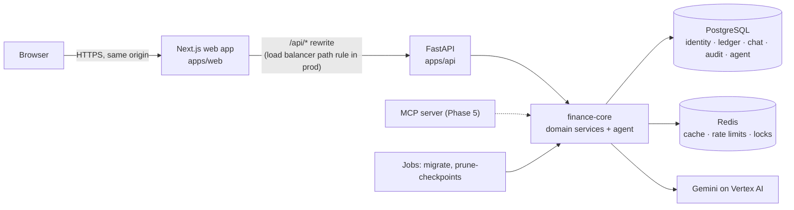
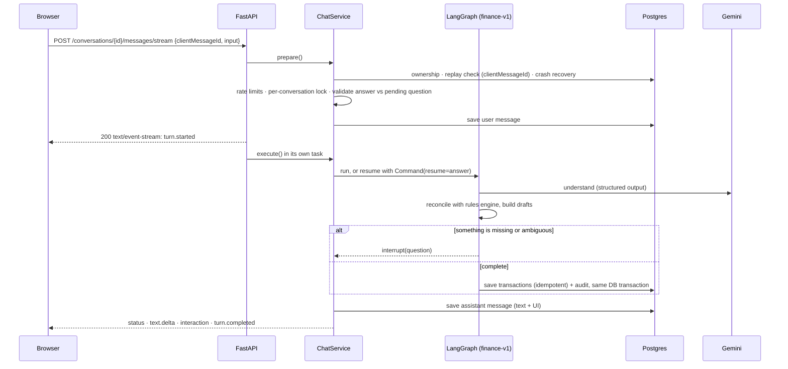

# Architecture

How MoneyMoney is put together, why it is shaped this way, and what has to be true to run
it in production. For setup and commands, see the [README](../README.md).

## Shape and sizing

MoneyMoney is a **modular monolith**. There is one Python core library, one API service, and
one web app, backed by one Postgres database and one Redis instance.

This matches the expected load. A personal finance app with up to around 100K users sees
tens of requests per second at peak. Most of those are small writes and reads scoped to one
user, and the expensive part is the LLM call, not the database. One well-indexed Postgres
handles that comfortably, so microservices would add network hops, retries and deploys
without solving a problem we have.

Financial correctness pushes the bar up, though. Even at low traffic, money must be exact,
saves must be idempotent, every change needs an audit trail, and one user must never see
another user's data. Those requirements shape most of the decisions below.

The seams for growth are already in place. Domain services know nothing about HTTP or the
LLM, so an MCP server (Phase 5) or a background worker can reuse them unchanged.

## Components



- **Postgres is the only source of truth.** It holds financial records, chat transcripts,
  the audit log and workflow checkpoints.
- **Redis is never authoritative.** If it disappears, the app gets slower and less
  protected, but it stays correct (see [Failure behaviour](#failure-behaviour)).
- **The browser only talks to the web origin.** `/api/*` is forwarded to FastAPI, so the
  session cookie is first-party and there is no cross-origin surface.

## Code boundaries

```text
apps/api/finance_api        HTTP only: routing, auth dependencies, error envelope, SSE
        │
backend/finance_core
  ├── agents/               chat turn lifecycle, LangGraph runtime, checkpointer, retention
  ├── workflows/            the graph: nodes, state, drafts, questions, reconciliation
  ├── llm/                  provider-neutral client, Gemini, rules engine, resilience
  ├── transactions/ reports/ categories/ users/ auth/ conversations/ audit/
  │                         domain services (no HTTP, no LLM, no LangGraph)
  ├── cache/ database/ observability/
  └── money.py dates.py ids.py clock.py errors.py config.py
```

import-linter enforces two rules in CI:

1. `finance_core` never imports `finance_api`, FastAPI or Starlette.
2. Domain services never import the workflow, agent or LLM layers.

So every capability is an ordinary async service method that takes a `UserContext`. REST
routes, graph nodes and future MCP tools all call the same methods, and authorization lives
in one place.

## Data model

Five Postgres schemas, each owned by one module:

| Schema | Tables | Notes |
| --- | --- | --- |
| `identity` | `users`, `financial_profiles`, `auth_sessions`, `password_reset_tokens` | Profile holds base currency, timezone and locale. Sessions and reset links store a SHA-256 of the token, never the token itself |
| `ledger` | `categories`, `transactions` | 23 system categories are seeded with deterministic ids. Users can add their own |
| `chat` | `conversations`, `messages` | The transcript, including the structured UI each assistant message rendered |
| `audit` | `audit_events` | Written in the same database transaction as the change it records |
| `agent` | LangGraph checkpoint tables | Working memory for unfinished turns. Safe to prune |

Conventions:

- **Ids** are UUIDv7: time-ordered, so inserts stay index-friendly, and they are safe to
  expose.
- **Money** is an integer in minor units (`amount_minor`) plus an ISO 4217 `currency`.
  Precision comes from an exponent table (JPY 0, INR 2, KWD 3). Input with more precision
  than the currency allows is rejected, never rounded. Formatting (₹1,23,456.78) happens at
  the edge, using Babel.
- **Dates:** a transaction stores `occurred_on DATE` in the user's own calendar. "Today",
  "last month" and "this week" resolve deterministically in the user's timezone, from an
  injected clock, so tests can pin time.
- **Transactions:** the type is `expense`, `income` or `transfer`. A row is soft-deleted
  (`deleted_at`) and can be restored. It carries an optimistic-lock `version`, a `source`
  (chat, manual, import or api) and an optional `source_ref` pointing at the chat message
  that created it.
- **Idempotency:** `UNIQUE (user_id, idempotency_key)` with
  `INSERT … ON CONFLICT DO NOTHING`, then the existing row is returned. A retry returns
  200 with the original row instead of creating a duplicate.
- **Hot-path index:** `(user_id, occurred_on DESC, id DESC) WHERE deleted_at IS NULL`. It
  serves listing, keyset pagination and the period sums behind every summary.

## A chat turn, end to end



What makes this robust:

- **All errors that can be known before streaming** (404, 409, 422, 429) are raised in
  `prepare()`, so they come back as proper HTTP statuses, not as events inside a 200
  stream.
- **The turn runs in its own task.** If the browser disconnects, the turn still
  finishes, and the reply is there on reload.
- **Retries are safe.** The client generates `clientMessageId` once per message and reuses
  it on retry. A finished turn is replayed as a single `turn.completed` event, never run
  twice.
- **One turn at a time per conversation.** A Redis lock prevents double-texting from racing
  the same workflow thread. A second concurrent message gets a 409.
- **Crash recovery:** if the graph finished but the process died before the transcript
  write, the checkpoint's `last_message_id` lets the next request detect this and recover.
- **Streaming survives proxies.** Event streams send
  `Cache-Control: no-store, no-transform`, which stops proxies (including Next.js's gzip
  on the rewrite) from buffering them.

Event types (`TurnEvent` in the OpenAPI document): `turn.started`, `status`, `text.delta`,
`interaction`, `turn.completed`, `error`. Interactions are typed UI payloads:
`clarification`, `confirmation`, `transactions_saved`, `summary`, `transaction_list` and
`suggestions`. The web app renders each one as a card. Answers come back as
`{"type": "interaction_response", …}` and are validated against the pending question
before the workflow resumes.

## The workflow

```text
START -> understand --+--> prepare_record <--> clarify (interrupt)
                      |         |                 |
                      |         +--> save --------+--> respond -> END
                      +--> summarize ----------------> respond
                      +--> search -------------------> respond
                      +------------------------------> respond
```

**State rules** (`workflows/state.py`):

- State holds plain JSON values only. Checkpoints stay small, deserialisation runs in
  strict mode (`allowed_msgpack_modules=None`), and schema evolution is just "read with
  defaults".
- Every key has exactly one writer per step, so the state needs no reducers.
- Identity (user, conversation, timezone, today's date) lives in `TurnContext`, LangGraph's
  `context_schema`, never in state. A node cannot change who it acts for, and identity is
  not copied into every checkpoint.

**Checkpointing and durability.** An `AsyncPostgresSaver` writes to the `agent` schema
with `durability="exit"`, which means one checkpoint write per turn instead of one per
step.

This is safe because the only side effect, saving transactions, is idempotent:

- Draft ids are derived deterministically from `(message_id, index)`.
- `save` checks `source_ref` before inserting.

If a process dies mid-turn, the retry re-runs the turn from the last checkpoint and lands on
the same rows.

**Clarification** uses `interrupt()`. Rounds are bounded (`AGENT_MAX_CLARIFICATION_ROUNDS`,
5), and a pending question expires after `AGENT_PENDING_TTL_HOURS` (24). If the user types
something unrelated instead of answering, the draft is abandoned explicitly rather than
being silently guessed.

**Versioning.** Node names and state keys are persisted, so renaming one is a migration:

1. Bump `GRAPH_VERSION`.
2. Route new threads to the new graph.
3. Let old threads drain.

**Retention.** Checkpoints are working memory, not records: the transcript is in
`chat.messages` and the money is in the ledger. `manage prune-checkpoints` drops threads
inactive for 30 days, and should be scheduled daily.

## Understanding messages (LLM layer)

- `LLMClient` is a two-method protocol: `understand()` returns structured output, and
  `stream_reply()` returns text. Gemini and the offline rules engine both implement it.
- **Gemini:** `gemini-3.5-flash-lite` with thinking level `low`, using JSON-schema
  structured output. Prompts are versioned files (`llm/prompts/*_v1.md`), and the version
  is logged with every call.
- **Reconciliation** (`workflows/reconcile.py`): the model's output is merged with the
  deterministic rules parse. This step:
  - fills gaps
  - merges split fragments
  - drops duplicate drafts
  - resolves relative dates in code
  - maps a "fallback" category to *unknown*, so the user is asked instead of a category
    being invented
- **Guards:** an amount the model inferred, rather than read from the text, must be
  confirmed. Replies are checked so they never state a number the system did not compute.
- **Resilience:** per-attempt timeout, one retry, and a total budget of 20 s. After that,
  the turn falls back to the rules engine (`degraded: true` in the message metadata).
- **Why these settings:** they were chosen from the eval set (`tests/evals`, repeated live
  runs).

  | Setup | Accuracy | Latency | Verdict |
  | --- | --- | --- | --- |
  | flash-lite + `minimal` | 51% | | Rejected |
  | flash-lite + `low` | 87% | | |
  | flash-lite + `low` + reconciliation | 78/78 | p50 1.26 s, p90 1.65 s | Chosen |
  | 3.8-flash | 100% | 35 s tail | Rejected for chat |

  Prompt context must stay at the top of the prompt: moving it last made the model return
  nulls.

The LLM interprets intent. It never calculates. Every total comes from SQL.

## Financial correctness

- **Totals are SQL sums** over live rows, grouped by currency, inside the period resolved
  in the user's timezone. Different currencies are never added together (there is no FX
  conversion yet). Transfers are excluded from income and expense.
- **Every summary states its period and label** ("October 2026", 1–26 Oct), so the user can
  see exactly what was counted.
- **Edits use optimistic locking.** A stale `version` gets a 409, never a silent overwrite.
  Deletes are soft, with restore. Every create, update, delete and restore writes an
  audit event in the same database transaction.
- **Duplicates are prevented at three levels:** the client idempotency key, deterministic
  draft ids with a `source_ref` check, and a duplicate guard in reconciliation.

## Redis

| Use | Key idea | If Redis is down |
| --- | --- | --- |
| Summary cache | Key includes a per-user **data generation**, which every write bumps. Stale entries are never read; they simply expire | Computed from Postgres every time |
| Rate limits | Fixed window per user/IP (login, register, chat per minute and per day) | Fail open: availability wins, and the event is logged |
| Conversation lock | `SET NX` with a token; released only by its owner | Proceeds unlocked (logged). Saves are idempotent, so the worst case is a 409 later |

A circuit breaker stops the app from waiting on a dead Redis, and socket timeouts are
500 ms.

## Auth and security

- **Server-side sessions.** The client gets an opaque 256-bit token in the `mm_session`
  cookie (HttpOnly, SameSite=Lax, Secure in production) or as a Bearer token for API
  clients.
  - Only its SHA-256 is stored.
  - Expiry slides to 30 days with activity, capped at 90 days absolute.
  - Logging out revokes the session server-side, so it stops working immediately.
- **Passwords** use Argon2id, hashed in a worker thread behind a semaphore so that login
  bursts cannot starve the event loop.
- **Password reset** (`auth/password_reset.py`) emails a link to
  `<WEB_BASE_URL>/reset-password#token=…`; the token sits in the URL fragment, so it never
  reaches a server log or a Referer header.
  - The request always gets the same 202, and the account lookup and email happen after
    the reply, so neither its body nor its timing shows whether an account exists. It is
    rate-limited per email (hashed) and per IP.
  - Only the token's SHA-256 is stored. A link works once, for 30 minutes, and a newer
    link replaces it. One atomic UPDATE checks and claims it, so two uses cannot both win.
  - Using it sets the password and signs out every session in one transaction.
  - Email goes through `EmailSender` (`email_sender.py`). Until a provider is chosen the
    console sender prints the email locally and, in production, sends nothing and never
    logs the link.
- **Origin check.** Writes authenticated by cookie must come from an allowed origin. This is
  the CSRF defence alongside SameSite.
- **User isolation:** every query is scoped by the authenticated `user_id`. Integration
  tests assert that one user cannot read, change or even detect another user's data (404,
  not 403).
- **Logging:** request logs carry the method, path, status, duration and request id. Query
  strings and message text are never logged.
- **Security headers** (nosniff, frame DENY, referrer policy, HSTS when secure) are set on
  every response. API responses send `Cache-Control: no-store`.
- **Containers** run as non-root users. In the API image the code is owned by root and is
  read-only to the service user.

## API conventions

- Versioned under `/api/v1`, and documented by OpenAPI. In TypeScript, response fields are
  always required (null when absent), so the web app never has to guess whether a field
  might be missing.
- **Error envelope everywhere:** `{"error": {"code", "message", "requestId", "details"}}`.
  Validation errors never echo submitted values. A database outage returns 503 with
  `Retry-After`.
- `X-Request-ID` is accepted (or derived from Google's trace header) and returned on every
  response.
- Lists use keyset pagination (`cursor`), not offsets.
- `POST /transactions` accepts an `Idempotency-Key` header.
- **Health:** `/healthz` reports liveness without touching dependencies. `/readyz` requires
  Postgres; when Redis is down it still returns 200 but reports `degraded`.

## Web app

- Next.js 16 (App Router, Cache Components, partial prerendering) with React 19 and
  Tailwind 4. Server state lives in TanStack Query.
- API calls use `openapi-fetch` with types generated from the OpenAPI document, so a
  contract change shows up as a compile error.
- `proxy.ts` only routes optimistically (signed-out visitors go to `/login`). The API
  remains the authority on every request.
- The chat view consumes the SSE stream and renders typed interaction cards. A running
  "tally" strip shows this month's totals and refreshes after each save.

## Failure behaviour

| What fails | What the user sees | Mechanism |
| --- | --- | --- |
| Gemini slow or down | Normal reply, from the rules engine | Timeout plus total budget, then fallback. `degraded` is logged |
| Redis down | Everything works, slightly slower | Fail-open cache, limits and locks. `/readyz` reports degraded |
| Postgres down | "Can't reach your records" (503, retry) | Error envelope with `Retry-After`. `/readyz` returns 503 |
| Browser drops mid-turn | Reply appears on reload | Turn runs in its own task. The transcript is persisted |
| Client retries a message | Same result, no duplicate | `clientMessageId` replay, idempotent saves |
| Process crash mid-turn | Next message recovers the turn | Checkpoint `last_message_id` plus idempotent save |
| Two tabs send at once | The second gets "busy, try again" (409) | Per-conversation lock |
| Turn exceeds 60 s | Retryable error event | `AGENT_TURN_TIMEOUT_SECONDS` |

Integration tests cover the Gemini, Redis, retry, crash and two-tab rows. The Postgres row
is tested at the error-mapping level. The disconnect and timeout rows are not tested yet.

## Deployment on Google Cloud

The target layout. Infrastructure-as-code is not written yet; this section is the
specification for it.

| Piece | Service | Notes |
| --- | --- | --- |
| Web | Cloud Run service (`apps/web` image) | Stateless, scales on requests |
| API | Cloud Run service (`apps/api` image) | `ENVIRONMENT=production`, `LOG_JSON=true`, `COOKIE_SECURE=true` |
| Migrations | Cloud Run Job, same API image, `python -m finance_core.manage migrate` | Runs before each API rollout. Expand/contract migrations only, so the old version keeps working |
| Retention | Cloud Scheduler → Cloud Run Job, `manage prune-checkpoints` | Daily |
| Routing | External HTTPS load balancer: `/api/*` → API, everything else → web | Keeps one origin for cookies. Set `FORWARDED_ALLOW_IPS` to the LB ranges, never `*` on a public service |
| Database | Cloud SQL for PostgreSQL 17, private IP, automated backups + PITR | One regional instance; HA when downtime starts costing money |
| Cache | Memorystore for Redis 7.x, private | Basic tier is acceptable because Redis is never authoritative |
| LLM | Vertex AI | The API's service account needs `roles/aiplatform.user`. No key files: ADC comes from the service identity |
| Secrets | Secret Manager → Cloud Run env bindings | `DATABASE_URL`, `REDIS_URL` |
| Observability | Cloud Logging (JSON logs with request id and trace) + Cloud Monitoring | Alert on 5xx rate, p95 turn latency, `degraded` turns, Cloud SQL connections |

Settings that must be right in production:

- **`ALLOWED_ORIGINS`** must be the public origin, or every cookie write is rejected.
- **`WEB_BASE_URL`** must be the public web origin, or reset links point elsewhere.
- **The connection budget.** Each API instance uses at most
  `DATABASE_POOL_SIZE + DATABASE_MAX_OVERFLOW + CHECKPOINT_POOL_MAX_SIZE` connections
  (10 + 5 + 5 = 20 by default). Cloud Run `max-instances × 20` must stay below Cloud SQL's
  `max_connections` with headroom. When it does not, enable Cloud SQL managed connection
  pooling (transaction mode) and keep `DATABASE_PREPARED_STATEMENTS=false`.
- **Behind a pooler, connection startup options may be rejected.** The API currently sets
  `search_path` (checkpointer) and `statement_timeout` as startup options. Behind a pooler,
  set them on the database role instead:
  `ALTER ROLE … SET search_path = agent, public; ALTER ROLE … SET statement_timeout = '5s'`.
- **Concurrency.** Cloud Run concurrency of around 40 per API instance suits a workload
  that mostly waits on the LLM. A turn holds a database connection only while it is
  reading or writing, not while it waits for Gemini.

## Scale plan

Where the system bends first, and what to do about it:

1. **LLM latency and quota.** This is the first bottleneck by far.
   - Watch: p95 turn latency, Vertex 429s, `degraded` turns.
   - Do: request a quota increase, shorten prompts (`understand` currently uses about
     2.7K input tokens), and route easy messages to the rules engine first.
2. **Database connections.** This comes before CPU.
   - Watch: Cloud SQL connections, pool wait time.
   - Do: managed connection pooling, then read replicas for summaries and search.
3. **Summary queries for heavy users.** The index already covers them.
   - Do, in order: rely on the generation cache, then a monthly rollup table maintained on
     write, then partitioning `ledger.transactions` by `user_id` hash. Only at that point
     consider sharding.
4. **Checkpoint table growth.** Retention handles this. If volume grows, partition by
   month or shorten the inactivity window.

## Deliberately not doing yet

| Not doing | Why | Trigger to revisit |
| --- | --- | --- |
| Microservices | One team, one deployable; distribution adds failure modes | Separate teams needing independent deploys, or one part needing very different scaling |
| Message queue / event bus | No asynchronous work yet | Phase 3 imports (long-running parsing), scheduled summaries |
| FX conversion | Totals per currency are exact; conversion needs a rate source and a policy | Users with multi-currency spending asking for a single total |
| Read replicas | One primary handles the load | Primary CPU above about 60% sustained, or summary queries above about 30% of load |
| Multi-region | 99.9% single-region is the target | Contractual availability above 99.95%, or users across continents |
| Long-term memory store | The profile covers timezone, currency and locale | Phase 2/4 preferences: merchant → category mappings, reporting preferences |
| Infrastructure as code | No cloud environment yet | First staging deployment (Terraform in `infrastructure/gcp/`) |
